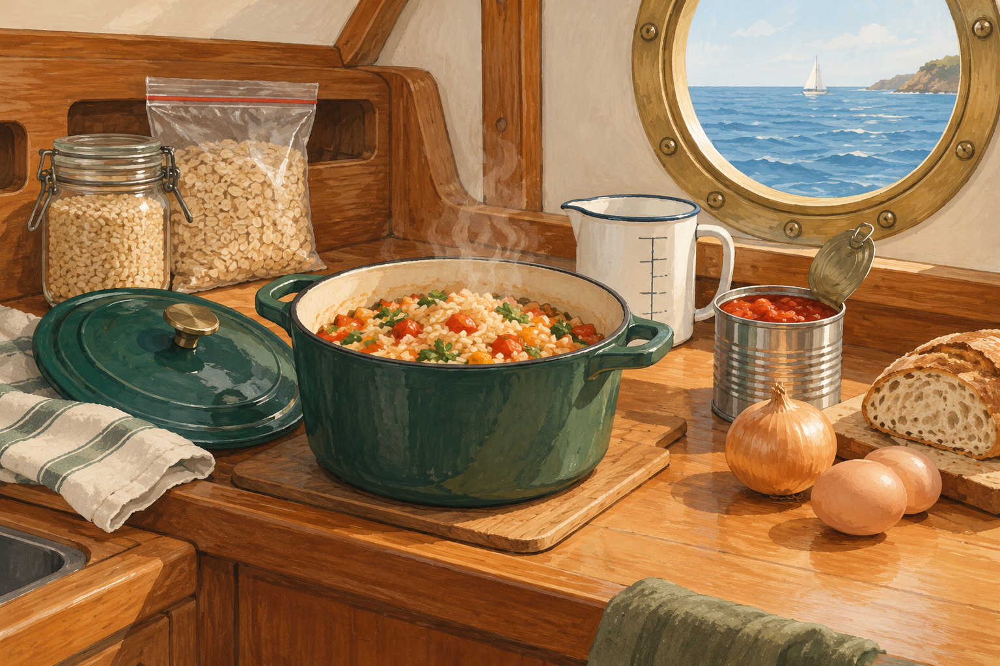

# deelkombuese · Smart Galley

**Simple meals for a crew of one to four, with no fridge and no wasted open packs.**



Smart Galley is the cooking companion to [deelstuff](https://deelstuff.com). Start with the provisions you can keep aboard, explore what they can become, and build a practical shopping list for your next passage. Recipes explain the small details a beginner needs: how to measure grain, when to turn down the heat, and what to check before serving.

[Open the app](https://kombuese.deelstuff.com/) · [Browse the architecture](docs/architecture.md) · [Deployment](docs/publishing.md)

## What you can do

- **Explore ingredients visually.** The flavour map filters recipes by compatible ingredients, including substitutions and optional additions.
- **Plan for a humid boat.** Compare unopened and opened storage guidance, packaging advice and approximate satiety. Fresh and dried forms remain distinct.
- **Cook by chapter.** Each chapter is a generator: pick the base, sauce and filling in one sentence and the dish, its water, time and shopping are worked out; every combination has its own link.
- **Build a dish.** Choose a base, sauce and protein. Pasta, risotto, rice and potatoes use their own cooking method and water calculation. Fresh cabbage has its own braised / unstuffed cabbage-roll base.
- **Find a dish from a search.** Every chapter, dish, recipe and product has its own page in each language (for example `/generators/eggs/shakshuka/` or `/en/products/passata/`), readable without JavaScript and listed in the sitemap; the app opens on it.
- **Use the whole pack.** Perishable tins, cartons and even a small cabbage head are planned as whole units; the recipe shows its resulting yield.
- **Cook for the crew.** Choose one to four people once: a recipe takes a bigger pack or several and scales the rest from it, and the passage menu, water, seasonal kit, shopping list and PNG card follow.
- **Provision a passage.** Generate a one-to-seven-day menu, a shopping list, a water budget and a gas estimate from each dish's burner minutes and your stove's rate, or prepare a replenishable seasonal pantry.
- **Save gas with a thermos.** Buckwheat, couscous and savoury oats can swell in a preheated food thermos, with the food-safety limits spelled out; rice stays on the stove.
- **Cook at the stove.** «At the stove» shows one large step per screen, starts a timer from the time the step names, keeps timers of earlier steps running and keeps the screen on where the browser allows it; arrow keys move between steps.
- **Keep instructions handy.** Save a configured favourite in your browser and download its ingredients and illustrated steps as a PNG card. After the initial cache is ready, the app works offline.

The interface, provisions, instructions, exports and legal pages are available in **Russian, English and German**. An explicit language choice wins over a saved preference; a first visit uses the first supported browser language, falling back to English. Shareable links use `?lang=en`, `?lang=de` or `?lang=ru` and retain the current section; a page address carries its language itself (`/en/…`, `/de/…`, Russian at the root).

## Run locally

Use Node.js 22 or newer and pnpm 11.25.0.

```sh
git clone https://github.com/iatsuk/deelkombuese.git
cd deelkombuese
pnpm install --frozen-lockfile
pnpm start
```

Open <http://127.0.0.1:4173>. On macOS, `start-local.command` also starts the server. Change the port with `PORT=8080 pnpm start`.

The app has **no runtime dependencies or backend**. Development tools provide formatting, source analysis and static-page generation. Serve it over HTTP; opening `index.html` as a local file cannot load the modules or service worker correctly.

## Verify and publish

```sh
pnpm check
pnpm test
pnpm format:check
pnpm build:pages
```

GitHub Actions runs the checks and publishes the allowlisted `dist/` directory after a push to `main`. DNS and HTTPS setup are covered in [publishing](docs/publishing.md). Production analytics use the existing self-hosted GoatCounter service at `stats.deelstuff.com`; local development, automated browsers and privacy opt-outs are excluded.

## Documentation

- [Architecture and module ownership](docs/architecture.md): dependency direction, editing guide and automated boundaries.
- [Design system](docs/design.md): colour tokens, light and dark themes, type scale and avoided devices.
- [Languages](docs/languages.md): detection, translation catalogues, coverage and PNG snapshots.
- [Provisioning model](docs/provisioning.md): whole packs, substitutions, water and storage assumptions.
- [Analytics](docs/analytics.md): shared adapter, collector configuration and privacy behaviour.
- [Publishing](docs/publishing.md): static build, GitHub Pages, DNS, HTTPS and rollback.
- [Visual assets](docs/visual-assets.md): image provenance and reusable action pictograms.

## Planning assumptions

Storage periods are editorial planning estimates under the stated conditions, not laboratory-tested shelf lives for a humid yacht. Warm lockers and condensation shorten them. The manufacturer's limits take precedence. Long cabbage storage needs genuinely cold conditions; the app's short whole-head plan does not promise root-cellar performance aboard.

Open perishable food and cooked meals must be used promptly. The catalogue explains conditional egg storage and the cold chain for shore-bought meat, ham and cheese. Satiety is a rough guide, not a measured individual prediction. The passage planner is a deterministic menu rotation, not a nutrition or cost optimiser.

Fonts are bundled under the [SIL Open Font License](fonts/literata-OFL.txt). Food references are linked from the app. The generated galley illustration is editorial artwork, not a photograph of a particular recipe or a food-storage instruction.
