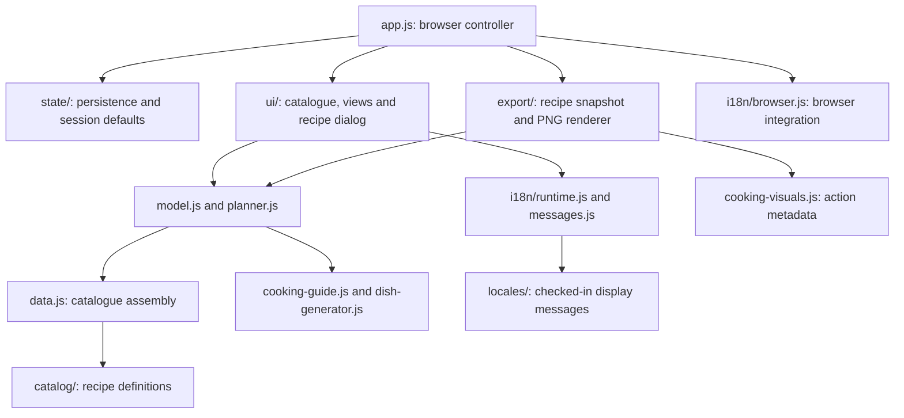

# Architecture and maintenance

Smart Galley is a static ES-module application. The browser owns user state, rendering and PNG downloads; there is no application server or database. The development server and GitHub Actions are delivery tools, not runtime dependencies.

## Dependency direction

The diagram shows responsibilities, not every import. `pnpm check:architecture` verifies actual imports, rejects cycles and undefined names, reports unused imports, and enforces the boundaries below.

## Ownership and public entry points

| Concern                           | Owner                                           | Contract                                                                                   |
| --------------------------------- | ----------------------------------------------- | ------------------------------------------------------------------------------------------ |
| Product and recipe identity       | `data.js`, `catalog/`, `recipe-library.js`      | Stable IDs and canonical units; no DOM, network or locale access                           |
| Recipe calculations               | `model.js`                                      | `prepareRecipe`, substitutions, whole packs, filtering and shopping aggregation            |
| Cooking techniques                | `cooking-guide.js`, `dish-generator.js`         | Water absorption, preparation order, base-specific steps; no presentation imports          |
| Passage and seasonal provisioning | `planner.js`                                    | Deterministic menus, retail rounding, usage and water budgets                              |
| Configured favourites             | `preferences.js`                                | Normalised selections and legacy recipe migrations                                         |
| Persistence                       | `state/storage.js`                              | Storage is injected; corrupt or unavailable storage does not prevent use                   |
| Session defaults                  | `state/session.js`                              | `createAppState` creates a fresh session from saved data and the route                     |
| UI catalogue                      | `ui/catalog.js`                                 | Shared cards, selection-aware filtering, search and shopping selectors                     |
| Page rendering                    | `ui/views/`                                     | One module per primary section, with explicit state/catalogue inputs                       |
| Recipe detail                     | `ui/recipe-dialog.js`                           | Presentation of an already prepared recipe; actions remain in the controller               |
| Graph geometry                    | `ui/graph.js`                                   | DOM measurement and SVG connections only                                                   |
| SVG and display formatting        | `ui/icons.js`, `ui/format.js`, `ui/water.js`    | Shared visual vocabulary and locale-aware display                                          |
| Language policy                   | `i18n/locale.js`                                | Pure precedence and shareable language URLs                                                |
| Display translation               | `i18n/messages.js`, `runtime.js`, `html.js`     | Exact messages and parameter patterns; only public text and accessible labels change       |
| Browser language integration      | `i18n/browser.js`                               | Reads preferences, loads a catalogue and exposes the selector                              |
| PNG snapshot                      | `export/recipe-card.js`, `i18n/recipe-card.js`  | Captures the selected recipe before asynchronous rendering, then localises display fields  |
| PNG drawing                       | `export/png.js`                                 | Reads a complete snapshot; never reads application state, the product catalogue or storage |
| Shopping text                     | `export/shopping-list.js`                       | Pure text export with explicit plan/items and translator/language inputs                   |
| Compatibility exports             | `recipe-export.js`                              | Keeps the previous import path working without duplicating implementation                  |
| Analytics                         | root `site-analytics.js`                        | Byte-identical copy of the authoritative `web-analytics` adapter                           |
| Legal pages and offline manifest  | `scripts/legal-pages.mjs`, `offline-assets.mjs` | Deterministic generation from checked-in inputs                                            |

## Architectural rules

- **ARCH-01 — Domain independence.** Domain and catalogue modules cannot import UI, browser integration, persistence or exports, and cannot access browser globals or fetch resources. Recipe definitions are separated from the generator's cooking algorithms.
- **ARCH-02 — No reverse controller dependencies.** Views cannot import `app.js`. The controller owns browser events and delegates rendering and calculations through small explicit interfaces.
- **ARCH-03 — Snapshot exports.** The PNG renderer receives prepared display data. Changing a selection while a download is being created cannot alter that download.
- **ARCH-04 — Locale is presentation.** Never translate IDs, option values, `data-*` attributes, stored units, recipe choices or numeric measurements. Browser integration is isolated from the pure translator and locale policy.
- **ARCH-05 — Checked dependencies.** Imports must be acyclic. New unresolved names and unused imports fail the architecture gate.
- **ARCH-06 — Static delivery.** Only explicitly allowlisted runtime files enter `dist/`. Tests, documentation, development scripts, Git metadata and credentials are excluded.

## Applying design principles

KISS and YAGNI take precedence over speculative extensibility. Use plain functions, data objects and direct ES-module imports. Do not introduce a service container, event bus, class hierarchy or framework to support hypothetical features.

GRASP's Information Expert places quantities, pack scaling and water rules beside the domain data and calculations. The browser controller coordinates events; views have high cohesion around a single section. Persistence and translation are adapters rather than hidden dependencies of recipe calculations.

GoF patterns are tools, not a compliance checklist. The existing cooking-technique functions provide a small strategy-like variation point; the export snapshot separates preparation from rendering. Extra factories, observers and abstract base classes would add indirection without solving a current problem.

Clean Code here means descriptive ownership, readable formatting, explicit inputs, short comments for policy and units, and tests of meaningful outcomes. A rendering template may be long because it describes a full section; split it when a part has an independent responsibility, not merely to meet an arbitrary line count.

## Editing a feature in isolation

- A product or dish: start in `data.js` or its `catalog/` definition and update both language catalogues. Preserve its ID.
- Pack or water behaviour: edit `model.js`, the relevant cooking technique or `planner.js`; verify the affected quantities and generated steps.
- A page layout: edit its `ui/views/` module and stylesheet. It should not require changes to persistence or recipe calculations.
- Language behaviour: use `i18n/locale.js` and `browser.js`; wording belongs in `locales/`, with numeric/placeholder coverage tests.
- A PNG layout: use `export/png.js`. The renderer must continue to work solely from its snapshot.
- Analytics: update the independent shared source first, then synchronise website copies; see [analytics](analytics.md).

## Verification

Run `pnpm check`, `pnpm test`, `pnpm format:check` and `pnpm build:pages`. Tests cover domain outcomes, storage failures, language precedence, translated recipe variants, immutable numeric data, analytics privacy gates and the static package. Browser checks cover the actual language selector, translated search, favourites, PNG downloads and responsive layouts. Static checks do not establish editorial or legal accuracy.
